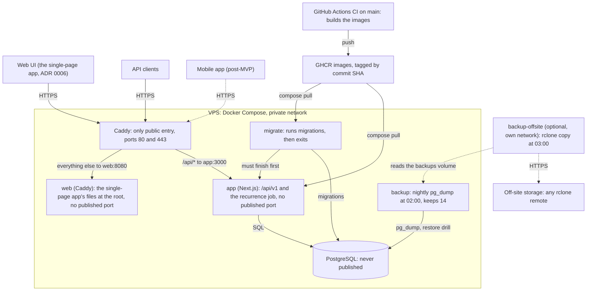

# Architecture overview

Hearth is a modular monolith. One Next.js application hosts the versioned HTTP API under `/api/v1`, a single-page app is the web UI, and a single PostgreSQL database holds the data. This page shows how it is deployed, how a request travels through the code, which modules exist and which rules keep them apart. The source of truth for every decision is the [design spec](../specs/2026-10-11-hearth-design.md); this page summarises it and points back to it.

The database has its own page: [data model](data-model.md).

## Deployment

The production stack is Docker Compose on a VPS: Caddy, the `app` container, the `web` container (the single-page app's files, [ADR 0006](../adr/0006-client-first-single-page-app.md)), PostgreSQL, a one-shot `migrate` container and the nightly `backup` container. CI builds the images; the operator pulls them by commit SHA. The steps are in [Deploying Hearth to a VPS](../operations/deploy.md); the definitions are [`compose.yaml`](https://github.com/Facabore/Hearth/blob/development/compose.yaml) and [`Caddyfile`](https://github.com/Facabore/Hearth/blob/development/Caddyfile).

What the files say:

- **Caddy** is the only service that publishes ports (`80`, `443` and `443/udp`). It terminates TLS, compresses responses, proxies `/api` and `/api/*` to `app:3000` and everything else to `web:8080`. It sets `X-Forwarded-For` to the real peer address, which the sign-in throttles rely on.
- **`web`** publishes no port. It is a Caddy holding the single-page app's build (`Caddyfile.web`): `index.html` for every app path, the hashed assets with a year's cache, a 404 for a missing file, and a 308 from `/app` and `/app/*` to the same path at the root for bookmarks made before the cut-over of #199 (ADR 0006).
- **`app`** publishes no port. It starts only after `migrate` has completed successfully, and it records due recurring transactions itself with an in-process timer ([recurring transactions job](../operations/deploy.md#recurring-transactions-job)).
- **PostgreSQL** is on the internal network only. Its data lives in the `db-data` volume, and its nightly dumps in the `backups` volume.
- **CI** (`.github/workflows/ci.yml`) runs lint, boundary check, typecheck and tests, builds the three images (`hearth`, `hearth-migrator` and `hearth-web`) and smoke-tests them, the first two against PostgreSQL. On a push to `main` it pushes them to GHCR tagged with the commit SHA and `main`. Releases are deployed by setting the image tags in `.env` to the SHA.
- **`backup`** runs `pg_dump` every night at 02:00 in `APP_TIMEZONE` into the `backups` volume and keeps the newest `BACKUP_RETENTION_DAYS` (14) files; `scripts/restore-drill.sh` restores the newest into a scratch database, checks its transaction count and drops it (HU-E8-01, [Backups and restore](../operations/backups.md)). It publishes no port.
- **`backup-offsite`** is optional (compose profile `offsite`, off by default): it copies the backups to any rclone remote at 03:00 and never deletes there; it is on its own network, without the database.

## Request lifecycle

What happens to a request such as `POST /api/v1/spaces/{spaceId}/expenses` ([spec section 7](../specs/2026-10-11-hearth-design.md#7-architecture)):

1. **Caddy** receives the request over HTTPS and proxies it to the `app` container.
2. **The route handler** in `src/app/api/v1/...`, built with `defineRoute` (`src/composition/route.ts`), handles the edges: it authenticates the caller (session cookie or Bearer token, both resolve the same user), validates the query and body against the Zod contract, and carries the request id (`X-Request-Id`).
3. **The use case** in the module's `application/` runs. Authorization is decided here, by the caller's `SpaceMember` and role, never only in the handler.
4. **The domain code** runs: entities, value objects and domain services, in pure TypeScript.
5. **Ports lead to Drizzle adapters.** The use case talks to ports; the container binds them to the `infrastructure/` adapters, and the adapters query PostgreSQL.
6. **A `Result` maps to the response.** A success becomes the JSON response; an error becomes an RFC 9457 `application/problem+json` response with a stable `code` and the request id.

## Web UI

The screens are a client-first single-page app in `src/spa` (Vite, React, TanStack Router and TanStack Query), served at the root with no locale in the URL ([ADR 0006](../adr/0006-client-first-single-page-app.md), [ADR 0003](../adr/0003-web-ui-talks-to-the-api-through-a-generated-client.md), ruling P117). Next.js serves only the API since the cut-over of #199:

- **Reads:** each route's loader reads `/api/v1` from the browser through the generated client into the query cache, so a screen seen before opens from the cache and revalidates.
- **Writes:** the same-origin `/api/v1` from the browser; each write updates the cache it changes. There are no server actions.
- **Session redirect:** the router's `beforeLoad` guards send a visitor without a session to `/sign-in?next=<path>`; only same-origin paths are honoured.
- **Language:** use-intl over the same `es` and `en` catalogs, from the stored locale, a visitor cookie or the browser (P120). The components keep importing `next-intl` and `next/*`; `vite.spa.config.ts` resolves those imports to the SPA's adapters.
- **Formats:** only `src/shared/ui/format/` formats numbers, dates and times, from the person's effective preferences (P121).
- **Open pages:** the invitation and claim screens open with or without a session (P157); they read the public previews `GET /api/v1/invitations/{token}` and `GET /api/v1/claims/{token}`, which answer without a session and never carry an email (P156).
- **Split preview:** the shared expense form previews a split in the browser with `previewSplit`, which mirrors the domain's `splitShares` (largest remainder, the currency's rounding unit, join order) and is pinned to it by a parity test; the request carries the person's choices, never the preview, and the server's answer is authoritative (P166).
- **Navigation trail:** `NavigationTracker` mirrors this tab's history in `sessionStorage` so `ScreenHeader`'s Volver can return to the nearest earlier screen, and a flow that saves replaces its own entry so its form leaves the trail; `returnTo` and `?from=` are validated like `safeNext`. The rules are in [the decisions index](../decisions/README.md#m6b-shared-spaces-split-expenses-and-balances-p155p183).
- **The Plan tab (M6c):** the bottom bar's Plan links to `/spaces/{spaceId}/plan`, whose views depend on the space's kind (Lines, Members, Fund, By group and Trend in a shared space; My spending, Próximos, By group, Trend and Lines in the personal one), and the planner lives at `/spaces/{spaceId}/plans/{planId}` with its capacities and line editor (P200). The screens are the module UIs `budgeting/ui` (planner, capacities, line and allocation editors) and `reporting/ui` (dashboards and the cash-flow calendar).
  - **Figures are the API's:** no screen sums, subtracts or recomputes an amount or a share it shows; the reports answer their totals (P201).
  - **Bars and charts:** bars are HTML widths inside the rows that carry their figures. Recharts draws only the two trends, in `reporting/ui/charts/*-chart.tsx`, which pages reach only through the lazy wrapper's `import()`; dependency-cruiser's `recharts-only-in-charts` and `charts-load-lazily` enforce it (P202).
  - **Plan writes** send `If-Match: "<version>"` of the last answer, and a 412 re-reads the plan (P206).
  - **The record form's line warning** is a labelled preview over the line dashboard the form's loader reads: it applies the kernel's `lineStateOf` to what would be left, so the form and the dashboard cannot disagree, and Save still sends one request (P233–P237, P244).
  - **The cash-flow calendar** (the personal space's Próximos) reads `GET /api/v1/me/cash-flow`, which reporting projects from the ledger's `listScheduledMovements` port: only known future items, by local date, with no action (P238–P241, P245, P246). The rules are in [the decisions index](../decisions/README.md#m6c-budget-planner-and-dashboards-p200p248).
- **Boundaries:** dependency-cruiser keeps UI code to the generated client and four pure kernel files, `time-zone.ts`, `local-date.ts`, `style.ts` and `line-state.ts` (P119, P244).
- **Screen entries:** a module exposes whole screens to the SPA only through `ui/screens.ts`, and client-safe pieces through `ui/index.ts`; dependency-cruiser's `ui-screens-only-for-the-spa` enforces it.
- **Speed:** each route is its own chunk, held to `tests/performance/spa-budgets.json` by `pnpm spa:budget`; `package.json` declares `sideEffects: ["**/*.css"]` so the bundler can drop what a route does not use from barrel files, and the sheets' Radix Dialog loads when the first sheet opens. [ADR 0004](../adr/0004-web-ui-testing-and-performance-gates.md) has the gates that hold the line.

## Modules

The eight modules live in `src/modules/<module>/` ([spec 5.1](../specs/2026-10-11-hearth-design.md#51-bounded-contexts-modules)). A tick means the folder exists today; `balances` and `reporting` are read models and have no tables, so they have no `infrastructure/`. Since M6a the `ui/` layer exists in `identity`, `spaces`, `accounts`, `categories` and `ledger`, since M6b in `balances`, and since M6c in `budgeting` and `reporting` too (presentational components; the SPA's loaders read the data).

| Module | Responsibility | `domain` | `application` | `contracts` | `infrastructure` |
|---|---|---|---|---|---|
| `identity` | Users, authentication, sessions | yes | yes | yes | yes |
| `spaces` | Personal, shared and direct spaces; members (registered or guest), roles, invitations, guest claims | yes | yes | yes | yes |
| `accounts` | Where money lives | yes | yes | yes | yes |
| `categories` | Customizable hierarchical categories per space | yes | yes | yes | yes |
| `ledger` | Expenses, incomes, transfers, settlements (and recurrences) | yes | yes | yes | yes |
| `balances` | Who owes whom inside a shared space (read model) | yes | yes | yes | none |
| `budgeting` | Monthly plans, lines, allocations, rollover | yes | yes | yes | yes |
| `reporting` | Dashboards and the unified personal view (read models) | yes | yes | yes | none |

Besides the modules, `src/shared/` holds the kernel (`Money`, `PeriodPolicy`, `Result`, ids, `Clock`), the HTTP layer (`defineRoute`, problem+json, pagination, idempotency, ETag) and the shared infrastructure (database client, transaction manager, logger). `src/composition/` is the composition root.

## Dependency rules

- **The rule.** `app → application → domain`, and `infrastructure → application / domain`. The domain imports only its own module's domain and the shared kernel.
- **Modules talk only through application ports.** Another module is reached only through `src/modules/<module>/application/index.ts`, its public API. The one exception is table files: a Drizzle `*.schema.ts` may import another module's `*.schema.ts` to declare a foreign key, and nothing else of that module.
- **The composition root wires the adapters.** `src/composition/container.ts` builds the container: it creates the Drizzle adapters and binds them to the ports the use cases declare. Route handlers get their use cases from it.
- **It is enforced.** [ADR 0001](../adr/0001-boundary-enforcement-with-dependency-cruiser.md) chose dependency-cruiser. The rules are in [`.dependency-cruiser.cjs`](https://github.com/Facabore/Hearth/blob/development/.dependency-cruiser.cjs) at the repo root and run in CI as `pnpm lint:boundaries`.

## Cross-cutting conventions

Each is decided in the [design spec](../specs/2026-10-11-hearth-design.md); this is where to look.

- **Money** is a `bigint` in minor units and is sent over the wire as a string, with its currency (D6, [key decisions](../specs/2026-10-11-hearth-design.md#6-key-decisions)).
- **Computed on read.** Balances, budget figures and reports are derived with queries and never stored (D7, [derived metrics](../specs/2026-10-11-hearth-design.md#54-derived-metrics-computed-on-read-never-stored)).
- **Logical deletes and the audit.** Every delete is logical; edits are kept in `transaction_audit` (D8).
- **Stored periods.** A plan's boundaries are stored when it is created, so a policy change never moves history (D10).
- **Idempotency keys.** The `Idempotency-Key` header is accepted on the POSTs that create a transaction or a recurrence; a replay returns the original response ([HTTP API conventions](../specs/2026-10-11-hearth-design.md#http-api-conventions)).
- **ETag and If-Match.** Updates of transactions and plans carry the row `version` as an `ETag`, and a mismatch returns `412` (same conventions).
- **Cursor pagination.** `?cursor=&limit=`, default 50, maximum 200 (same conventions).
- **OpenAPI from Zod.** Each module's `contracts/` holds the Zod schemas; the OpenAPI 3.1 document is generated from them with zod-openapi ([ADR 0002](../adr/0002-openapi-generator-zod-openapi.md)), served at `/api/v1/openapi.json`, and its reviewed snapshot is [`openapi/openapi.snapshot.json`](https://github.com/Facabore/Hearth/blob/development/openapi/openapi.snapshot.json).
- **Errors.** RFC 9457 `problem+json` with a stable `code`; the API never returns translated text.
