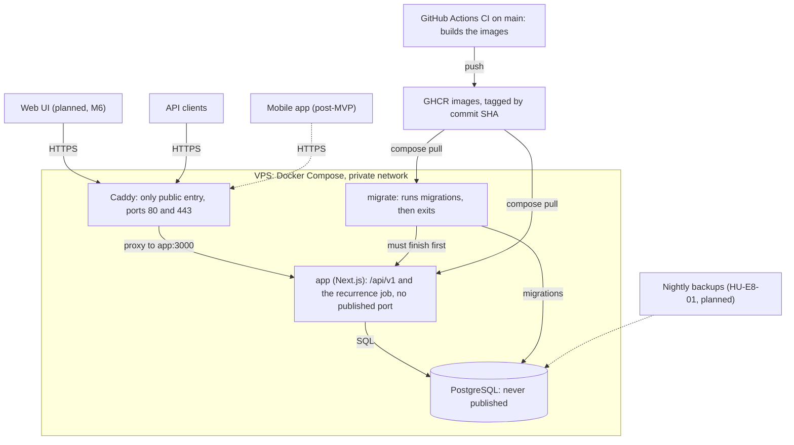

# Architecture overview

Hearth is a modular monolith. One Next.js application hosts the versioned HTTP API under `/api/v1`, and a single PostgreSQL database holds the data. This page shows how it is deployed, how a request travels through the code, which modules exist and which rules keep them apart. The source of truth for every decision is the [design spec](../superpowers/specs/2026-10-11-hearth-design.md); this page summarises it and points back to it.

The database has its own page: [data model](data-model.md).

## Deployment

The production stack is Docker Compose on a VPS: Caddy, the `app` container, PostgreSQL and a one-shot `migrate` container. CI builds the images; the operator pulls them by commit SHA. The steps are in [Deploying Hearth to a VPS](../operations/deploy.md); the definitions are [`compose.yaml`](https://github.com/Facabore/Hearth/blob/development/compose.yaml) and [`Caddyfile`](https://github.com/Facabore/Hearth/blob/development/Caddyfile).

What the files say:

- **Caddy** is the only service that publishes ports (`80`, `443` and `443/udp`). It terminates TLS, compresses responses and proxies everything to `app:3000`. It sets `X-Forwarded-For` to the real peer address, which the sign-in throttles rely on.
- **`app`** publishes no port. It starts only after `migrate` has completed successfully, and it records due recurring transactions itself with an in-process timer ([recurring transactions job](../operations/deploy.md#recurring-transactions-job)).
- **PostgreSQL** is on the internal network only. Its data lives in the `db-data` volume.
- **CI** (`.github/workflows/ci.yml`) runs lint, boundary check, typecheck and tests, builds the two images (`hearth` and `hearth-migrator`) and smoke-tests them against PostgreSQL. On a push to `main` it pushes them to GHCR tagged with the commit SHA and `main`. Releases are deployed by setting both image tags in `.env` to the SHA.
- **Backups** are not built yet. Until HU-E8-01 arrives, the deploy guide asks for a manual `pg_dump` before every update.

## Request lifecycle

What happens to a request such as `POST /api/v1/spaces/{spaceId}/expenses` ([spec section 7](../superpowers/specs/2026-10-11-hearth-design.md#7-architecture)):

1. **Caddy** receives the request over HTTPS and proxies it to the `app` container.
2. **The route handler** in `src/app/api/v1/...`, built with `defineRoute` (`src/composition/route.ts`), handles the edges: it authenticates the caller (session cookie or Bearer token, both resolve the same user), validates the query and body against the Zod contract, and carries the request id (`X-Request-Id`).
3. **The use case** in the module's `application/` runs. Authorization is decided here, by the caller's `SpaceMember` and role, never only in the handler.
4. **The domain code** runs: entities, value objects and domain services, in pure TypeScript.
5. **Ports lead to Drizzle adapters.** The use case talks to ports; the container binds them to the `infrastructure/` adapters, and the adapters query PostgreSQL.
6. **A `Result` maps to the response.** A success becomes the JSON response; an error becomes an RFC 9457 `application/problem+json` response with a stable `code` and the request id.

## Modules

The eight modules live in `src/modules/<module>/` ([spec 5.1](../superpowers/specs/2026-10-11-hearth-design.md#51-bounded-contexts-modules)). A tick means the folder exists today; `balances` and `reporting` are read models and have no tables, so they have no `infrastructure/`. The `ui/` layer is not there yet (the web UI is epic E9, milestone M6).

| Module | Responsibility | `domain` | `application` | `contracts` | `infrastructure` |
|---|---|---|---|---|---|
| `identity` | Users, authentication, sessions | yes | yes | yes | yes |
| `spaces` | Personal, shared and direct spaces; members (registered or guest), roles, invitations, guest claims | yes | yes | yes | yes |
| `accounts` | Where money lives | yes | yes | yes | yes |
| `categories` | Customizable hierarchical categories per space | yes | yes | yes | yes |
| `ledger` | Expenses, incomes, transfers, settlements (and recurrences) | yes | yes | yes | yes |
| `balances` | Who owes whom inside a shared space (read model) | yes | yes | yes | none |
| `budgeting` | Monthly plans, lines, allocations, rollover | yes | yes | yes | yes |
| `reporting` | Dashboards and the unified personal view (read models) | yes | yes | yes | none |

Besides the modules, `src/shared/` holds the kernel (`Money`, `PeriodPolicy`, `Result`, ids, `Clock`), the HTTP layer (`defineRoute`, problem+json, pagination, idempotency, ETag) and the shared infrastructure (database client, transaction manager, logger). `src/composition/` is the composition root.

## Dependency rules

- **The rule.** `app → application → domain`, and `infrastructure → application / domain`. The domain imports only its own module's domain and the shared kernel.
- **Modules talk only through application ports.** Another module is reached only through `src/modules/<module>/application/index.ts`, its public API. The one exception is table files: a Drizzle `*.schema.ts` may import another module's `*.schema.ts` to declare a foreign key, and nothing else of that module.
- **The composition root wires the adapters.** `src/composition/container.ts` builds the container: it creates the Drizzle adapters and binds them to the ports the use cases declare. Route handlers get their use cases from it.
- **It is enforced.** [ADR 0001](../adr/0001-boundary-enforcement-with-dependency-cruiser.md) chose dependency-cruiser. The rules are in [`.dependency-cruiser.cjs`](https://github.com/Facabore/Hearth/blob/development/.dependency-cruiser.cjs) at the repo root and run in CI as `pnpm lint:boundaries`.

## Cross-cutting conventions

Each is decided in the [design spec](../superpowers/specs/2026-10-11-hearth-design.md); this is where to look.

- **Money** is a `bigint` in minor units and is sent over the wire as a string, with its currency (D6, [key decisions](../superpowers/specs/2026-10-11-hearth-design.md#6-key-decisions)).
- **Computed on read.** Balances, budget figures and reports are derived with queries and never stored (D7, [derived metrics](../superpowers/specs/2026-10-11-hearth-design.md#54-derived-metrics-computed-on-read-never-stored)).
- **Logical deletes and the audit.** Every delete is logical; edits are kept in `transaction_audit` (D8).
- **Stored periods.** A plan's boundaries are stored when it is created, so a policy change never moves history (D10).
- **Idempotency keys.** The `Idempotency-Key` header is accepted on the POSTs that create a transaction or a recurrence; a replay returns the original response ([HTTP API conventions](../superpowers/specs/2026-10-11-hearth-design.md#http-api-conventions)).
- **ETag and If-Match.** Updates of transactions and plans carry the row `version` as an `ETag`, and a mismatch returns `412` (same conventions).
- **Cursor pagination.** `?cursor=&limit=`, default 50, maximum 200 (same conventions).
- **OpenAPI from Zod.** Each module's `contracts/` holds the Zod schemas; the OpenAPI 3.1 document is generated from them with zod-openapi ([ADR 0002](../adr/0002-openapi-generator-zod-openapi.md)), served at `/api/v1/openapi.json`, and its reviewed snapshot is [`openapi/openapi.snapshot.json`](https://github.com/Facabore/Hearth/blob/development/openapi/openapi.snapshot.json).
- **Errors.** RFC 9457 `problem+json` with a stable `code`; the API never returns translated text.
