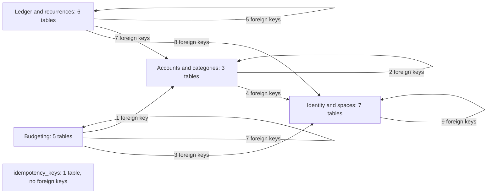
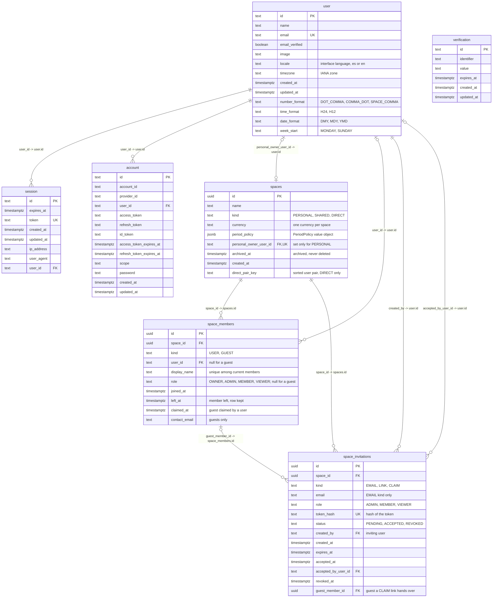
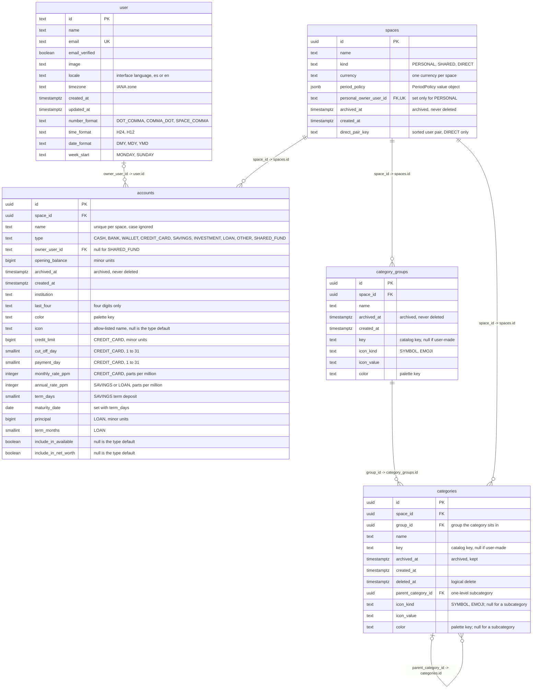
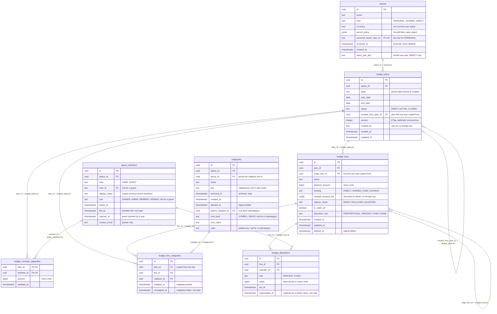
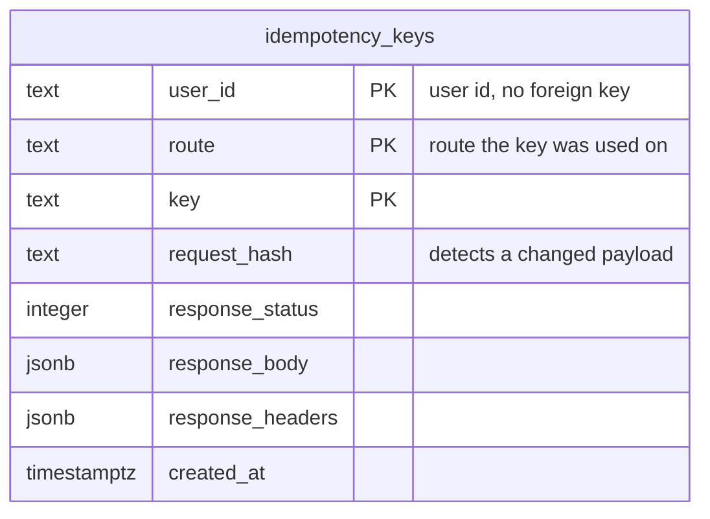

# Data model

This page describes the Hearth database: every table, every column with its SQL type, every key and every foreign key. It shows the final state after migration `0018_user_preferences`: **22 tables, 234 columns and 46 foreign keys**. The database is PostgreSQL and is reached only through Drizzle ORM.

For how the code that uses it is organised, see the [architecture overview](README.md).

## Sources and conventions

- **The migrations are authoritative.** This page is built from the SQL in [`drizzle/`](https://github.com/Facabore/Hearth/tree/development/drizzle) (`0000_init.sql` to `0018_user_preferences.sql`), applying every later `ALTER TABLE` to the table it changes. The `*.schema.ts` files in `src/modules/*/infrastructure/` and `src/shared/infrastructure/` declare the same tables for Drizzle; where this page and a migration disagree, the migration wins and this page is wrong.
- **Types** are PostgreSQL's names. `timestamptz` is `timestamp with time zone`. Money is `bigint` in minor units (D6). Better Auth's tables use `text` ids; every other table uses `uuid`.
- **Markers.** `PK` marks a column of the primary key (each column of a composite key is marked). `FK` marks a column that has a foreign key. `UK` marks a column that is unique on its own. Composite and partial unique indexes are not marked on a column; they are listed under each area's constraints.
- **Relationships.** One line per foreign key column, labelled `column -> target_table.target_column`. The line is drawn from the referenced table (left) to the table that holds the column (right). `||` on the referenced side means the column is `NOT NULL`, `|o` that it is nullable; `o{` on the holding side means many rows may point at one parent, `o|` that the column is also unique, so at most one does.
- **Quoted comments** on a column say what is not obvious. For a `text` column that holds a fixed list of values, the comment lists them; most of these lists are enforced in TypeScript, and only the ones named under "Unique indexes and checks" are enforced by PostgreSQL.
- **Better Auth.** The tables `user`, `session`, `account` and `verification` belong to Better Auth. `account` is the *sign-in* account (provider, tokens, credential), not the money `accounts` table. The `user` table also carries Hearth's own `locale`, `timezone` and the four formatting preferences.
- **Foreign keys never update.** Every foreign key is `ON UPDATE NO ACTION`; the tables below give the `ON DELETE` action.

## The whole database at a glance

All 22 tables with 234 columns do not fit one readable diagram, so the full-detail diagrams are drawn per area below. This map shows only how the areas point at each other: one arrow from an area to each area it references, labelled with the number of foreign key columns involved. An arrow that returns to its own area counts foreign keys between two tables of that area.

## Identity and spaces

The people and the places. `user`, `session`, `account` and `verification` are Better Auth's; `spaces` holds every kind of space, `space_members` holds who is in each (registered users and guests), and `space_invitations` holds the invitation and claim links.

**Foreign keys of this area (9).**

| From | To | Nullable | ON DELETE | Meaning |
|---|---|---|---|---|
| `session.user_id` | `user.id` | no | CASCADE | The user this session signs in. |
| `account.user_id` | `user.id` | no | CASCADE | The user this sign-in account belongs to. |
| `spaces.personal_owner_user_id` | `user.id` | yes | CASCADE | The owner of a PERSONAL space; set exactly when the kind is PERSONAL, and one personal space per user. |
| `space_members.space_id` | `spaces.id` | no | CASCADE | The space the member belongs to. |
| `space_members.user_id` | `user.id` | yes | CASCADE | The registered user behind a USER member; null for a guest. |
| `space_invitations.space_id` | `spaces.id` | no | CASCADE | The space the invitation is for. |
| `space_invitations.created_by` | `user.id` | no | CASCADE | The user who created the invitation. |
| `space_invitations.accepted_by_user_id` | `user.id` | yes | SET NULL | The user who accepted it; cleared if that user is deleted. |
| `space_invitations.guest_member_id` | `space_members.id` | yes | CASCADE | The guest whose place a CLAIM link hands over; set exactly for CLAIM invitations. |

**Unique indexes and checks.**

**`user`**
- Unique `user_email_unique`: `email`.
- Check `user_number_format`: `number_format` is `DOT_COMMA`, `COMMA_DOT` or `SPACE_COMMA` (null passes).
- Check `user_time_format`: `time_format` is `H24` or `H12` (null passes).
- Check `user_date_format`: `date_format` is `DMY`, `MDY` or `YMD` (null passes).
- Check `user_week_start`: `week_start` is `MONDAY` or `SUNDAY` (null passes).

**`session`**
- Unique `session_token_unique`: `token`.

**`account`**
- No unique index or check beyond the primary key.

**`verification`**
- No unique index or check beyond the primary key.

**`spaces`**
- Unique `spaces_personal_owner_user_id_unique`: `personal_owner_user_id`.
- Unique index `spaces_direct_pair_uq`: `direct_pair_key` where `archived_at IS NULL` (one active direct space per pair of users, D16).
- Check `spaces_personal_owner`: `(kind = 'PERSONAL') = (personal_owner_user_id IS NOT NULL)`.
- Check `spaces_direct_pair_kind`: `direct_pair_key IS NULL OR kind = 'DIRECT'`.

**`space_members`**
- Unique index `space_members_current_user_uq`: `(space_id, user_id)` where `left_at IS NULL` (one current row per user and space).
- Unique index `space_members_current_name_uq`: `(space_id, lower(display_name))` where `left_at IS NULL`.
- Check `space_members_guest_user`: `(kind = 'GUEST') = (user_id IS NULL)`.
- Check `space_members_guest_role`: `(kind = 'GUEST') = (role IS NULL)`.
- Check `space_members_contact_email`: `contact_email IS NULL OR kind = 'GUEST'`.

**`space_invitations`**
- Unique `space_invitations_token_hash_unique`: `token_hash`.
- Check `space_invitations_email_kind`: `(kind = 'EMAIL') = (email IS NOT NULL)`.
- Check `space_invitations_role`: `role IN ('ADMIN', 'MEMBER', 'VIEWER')`.
- Check `space_invitations_claim_guest`: `(kind = 'CLAIM') = (guest_member_id IS NOT NULL)`.
- Check `space_invitations_claim_role`: `kind <> 'CLAIM' OR role = 'MEMBER'`.

## Accounts and categories

Where money lives (`accounts`) and how spending is classified (`category_groups` and `categories`). Both belong to a space. `spaces` and `user` are drawn because the area points at them.

**Foreign keys of this area (6).**

| From | To | Nullable | ON DELETE | Meaning |
|---|---|---|---|---|
| `accounts.space_id` | `spaces.id` | no | CASCADE | The space the account belongs to: a personal space for a personal account, a shared space for a SHARED_FUND. |
| `accounts.owner_user_id` | `user.id` | yes | CASCADE | The user who owns a personal account; null for a SHARED_FUND. |
| `category_groups.space_id` | `spaces.id` | no | CASCADE | The space whose category tree the group is part of. |
| `categories.space_id` | `spaces.id` | no | CASCADE | The space the category belongs to. |
| `categories.group_id` | `category_groups.id` | no | NO ACTION | The group the category sits in; a subcategory carries its parent's group. |
| `categories.parent_category_id` | `categories.id` | yes | NO ACTION | The category a subcategory refines; null for a category directly in its group. One level only. |

**Unique indexes and checks.**

**`accounts`**
- Unique index `accounts_space_name_uq`: `(space_id, lower(name))`.
- Check `accounts_shared_fund_owner`: `(type = 'SHARED_FUND') = (owner_user_id IS NULL)`.
- Check `accounts_last_four`: `last_four ~ '^[0-9]{4}$'` (null passes).
- Check `accounts_card_terms`: `type = 'CREDIT_CARD'` or `credit_limit`, `cut_off_day`, `payment_day` and `monthly_rate_ppm` are all null.
- Check `accounts_annual_rate`: `annual_rate_ppm IS NULL OR type IN ('SAVINGS', 'LOAN')`.
- Check `accounts_loan_terms`: `type = 'LOAN'` or `principal` and `term_months` are both null.
- Check `accounts_term_deposit`: `(term_days IS NULL) = (maturity_date IS NULL)`, and a term needs `type = 'SAVINGS'`.
- Check `accounts_cut_off_day`: `cut_off_day` between 1 and 31 (null passes).
- Check `accounts_payment_day`: `payment_day` between 1 and 31 (null passes).
- Check `accounts_monthly_rate_range`: `monthly_rate_ppm` between 0 and 1000000 (null passes).
- Check `accounts_annual_rate_range`: `annual_rate_ppm` between 0 and 1000000 (null passes).
- Check `accounts_term_days_range`: `term_days` between 1 and 3660 (null passes).
- Check `accounts_term_months_range`: `term_months` between 1 and 480 (null passes).
- Check `accounts_credit_limit_positive`: `credit_limit > 0` (null passes).
- Check `accounts_principal_positive`: `principal > 0` (null passes).

**`category_groups`**
- Unique index `category_groups_space_name_uq`: `(space_id, lower(name))`.
- Unique index `category_groups_space_key_uq`: `(space_id, key)`; null keys never collide.

**`categories`**
- Unique index `categories_parent_name_uq`: `(coalesce(parent_category_id, group_id), lower(name))` where `deleted_at IS NULL` (names are unique among siblings).
- Unique index `categories_space_key_uq`: `(space_id, key)`; null keys never collide.
- Check `categories_not_own_parent`: `parent_category_id <> id`.
- Check `categories_style_whole`: `icon_kind`, `icon_value` and `color` are all null or all set.
- Check `categories_style_by_level`: `(parent_category_id IS NULL) = (color IS NOT NULL)`, so a category has a style and a subcategory has none.

## Ledger and recurrences

The money movements. A `transactions` row has its `payments`, its `shares` and its `transaction_audit` entries; `recurrences` and `recurrence_occurrences` schedule transactions. The tables from other areas are drawn because this area points at them.

```mermaid
erDiagram
    transactions {
        uuid id PK
        uuid space_id FK
        text type "EXPENSE, INCOME, TRANSFER, SETTLEMENT"
        text description
        date date "local date it counts in"
        uuid category_id FK "null for transfers and settlements"
        bigint amount "minor units"
        text currency
        uuid source_account_id FK
        uuid destination_account_id FK
        uuid receiving_member_id FK "INCOME receiver, SETTLEMENT payee"
        text created_by "user id, no foreign key"
        timestamptz created_at
        timestamptz updated_at
        timestamptz deleted_at "logical delete"
        integer version "ETag, optimistic concurrency"
        uuid payer_member_id FK "fund contributor, SETTLEMENT payer"
        timestamptz occurred_at "UTC instant, null if untimed"
        text time_zone "recorder's IANA zone"
    }
    payments {
        uuid transaction_id PK, FK
        smallint position PK "order within the transaction"
        uuid member_id FK "null only for a fund payment"
        uuid account_id FK "null for a guest payer"
        bigint amount "minor units"
    }
    shares {
        uuid transaction_id PK, FK
        smallint position PK "order within the transaction"
        uuid member_id FK
        bigint amount "minor units"
        text split_method "EQUAL, PERCENT, EXACT, SHARES, BY_ALLOCATION"
    }
    transaction_audit {
        uuid id PK
        uuid transaction_id FK
        text action "UPDATED, DELETED"
        text actor_user_id "user id, no foreign key"
        timestamptz at
        jsonb changes "ChangeSet, before and after"
    }
    recurrences {
        uuid id PK
        uuid space_id FK
        text type "EXPENSE, INCOME, TRANSFER, FUND_CONTRIBUTION"
        text description
        bigint amount "minor units"
        text currency
        uuid category_id FK
        uuid payer_member_id FK
        uuid source_account_id FK
        uuid destination_account_id FK
        jsonb split "ratios only, null is the default split"
        jsonb schedule "same shape as period_policy"
        text mode "AUTO, CONFIRM"
        date start_date
        date end_date
        date due_from "first date not considered yet"
        timestamptz paused_at "paused, kept"
        text pause_reason
        timestamptz ended_at "ended, kept"
        text created_by "user id, no foreign key"
        timestamptz created_at
        timestamptz updated_at
    }
    recurrence_occurrences {
        uuid id PK
        uuid recurrence_id FK
        uuid space_id FK
        date occurrence_date
        text status "RECORDED, PENDING, SKIPPED"
        bigint amount "minor units"
        uuid transaction_id FK, UK "set when RECORDED"
        text reason
        text resolved_by "user id, no foreign key"
        timestamptz created_at
        timestamptz resolved_at
    }
    spaces {
        uuid id PK
        text name
        text kind "PERSONAL, SHARED, DIRECT"
        text currency "one currency per space"
        jsonb period_policy "PeriodPolicy value object"
        text personal_owner_user_id FK, UK "set only for PERSONAL"
        timestamptz archived_at "archived, never deleted"
        timestamptz created_at
        text direct_pair_key "sorted user pair, DIRECT only"
    }
    categories {
        uuid id PK
        uuid space_id FK
        uuid group_id FK "group the category sits in"
        text name
        text key "catalog key, null if user-made"
        timestamptz archived_at "archived, kept"
        timestamptz created_at
        timestamptz deleted_at "logical delete"
        uuid parent_category_id FK "one-level subcategory"
        text icon_kind "SYMBOL, EMOJI; null for a subcategory"
        text icon_value
        text color "palette key; null for a subcategory"
    }
    accounts {
        uuid id PK
        uuid space_id FK
        text name "unique per space, case ignored"
        text type "CASH, BANK, WALLET, CREDIT_CARD, SAVINGS, INVESTMENT, LOAN, OTHER, SHARED_FUND"
        text owner_user_id FK "null for SHARED_FUND"
        bigint opening_balance "minor units"
        timestamptz archived_at "archived, never deleted"
        timestamptz created_at
        text institution
        text last_four "four digits only"
        text color "palette key"
        text icon "allow-listed name, null is the type default"
        bigint credit_limit "CREDIT_CARD, minor units"
        smallint cut_off_day "CREDIT_CARD, 1 to 31"
        smallint payment_day "CREDIT_CARD, 1 to 31"
        integer monthly_rate_ppm "CREDIT_CARD, parts per million"
        integer annual_rate_ppm "SAVINGS or LOAN, parts per million"
        smallint term_days "SAVINGS term deposit"
        date maturity_date "set with term_days"
        bigint principal "LOAN, minor units"
        smallint term_months "LOAN"
        boolean include_in_available "null is the type default"
        boolean include_in_net_worth "null is the type default"
    }
    space_members {
        uuid id PK
        uuid space_id FK
        text kind "USER, GUEST"
        text user_id FK "null for a guest"
        text display_name "unique among current members"
        text role "OWNER, ADMIN, MEMBER, VIEWER; null for a guest"
        timestamptz joined_at
        timestamptz left_at "member left, row kept"
        timestamptz claimed_at "guest claimed by a user"
        text contact_email "guests only"
    }
    spaces ||--o{ transactions : "space_id -> spaces.id"
    categories |o--o{ transactions : "category_id -> categories.id"
    accounts |o--o{ transactions : "source_account_id -> accounts.id"
    accounts |o--o{ transactions : "destination_account_id -> accounts.id"
    space_members |o--o{ transactions : "receiving_member_id -> space_members.id"
    space_members |o--o{ transactions : "payer_member_id -> space_members.id"
    transactions ||--o{ payments : "transaction_id -> transactions.id"
    space_members |o--o{ payments : "member_id -> space_members.id"
    accounts |o--o{ payments : "account_id -> accounts.id"
    transactions ||--o{ shares : "transaction_id -> transactions.id"
    space_members ||--o{ shares : "member_id -> space_members.id"
    transactions ||--o{ transaction_audit : "transaction_id -> transactions.id"
    spaces ||--o{ recurrences : "space_id -> spaces.id"
    categories |o--o{ recurrences : "category_id -> categories.id"
    space_members |o--o{ recurrences : "payer_member_id -> space_members.id"
    accounts |o--o{ recurrences : "source_account_id -> accounts.id"
    accounts |o--o{ recurrences : "destination_account_id -> accounts.id"
    recurrences ||--o{ recurrence_occurrences : "recurrence_id -> recurrences.id"
    spaces ||--o{ recurrence_occurrences : "space_id -> spaces.id"
    transactions |o--o| recurrence_occurrences : "transaction_id -> transactions.id"
```

**Foreign keys of this area (20).**

| From | To | Nullable | ON DELETE | Meaning |
|---|---|---|---|---|
| `transactions.space_id` | `spaces.id` | no | CASCADE | The space whose budget and balances the transaction affects. |
| `transactions.category_id` | `categories.id` | yes | NO ACTION | What the money was for; null for a TRANSFER or a SETTLEMENT. |
| `transactions.source_account_id` | `accounts.id` | yes | NO ACTION | The account a TRANSFER leaves; null for an EXPENSE, an INCOME and a transfer paid by a guest. |
| `transactions.destination_account_id` | `accounts.id` | yes | NO ACTION | The account an INCOME or a TRANSFER lands in. |
| `transactions.receiving_member_id` | `space_members.id` | yes | NO ACTION | The member who receives an INCOME or a SETTLEMENT. |
| `transactions.payer_member_id` | `space_members.id` | yes | NO ACTION | The member who contributes a TRANSFER into the shared fund, or pays a SETTLEMENT. |
| `payments.transaction_id` | `transactions.id` | no | CASCADE | The transaction the payment belongs to; deleting the transaction removes its payments. |
| `payments.member_id` | `space_members.id` | yes | NO ACTION | The member who paid; null for a payment from the shared fund. |
| `payments.account_id` | `accounts.id` | yes | NO ACTION | The account the money left; null when the payer is a guest. |
| `shares.transaction_id` | `transactions.id` | no | CASCADE | The transaction the share belongs to; deleting the transaction removes its shares. |
| `shares.member_id` | `space_members.id` | no | NO ACTION | The member who owes this part of the transaction. |
| `transaction_audit.transaction_id` | `transactions.id` | no | CASCADE | The transaction whose edit or deletion the entry records. |
| `recurrences.space_id` | `spaces.id` | no | NO ACTION | The space the recurrence records into. |
| `recurrences.category_id` | `categories.id` | yes | NO ACTION | Template category (EXPENSE and INCOME). |
| `recurrences.payer_member_id` | `space_members.id` | yes | NO ACTION | Template payer: the member paying an EXPENSE or making a FUND_CONTRIBUTION. |
| `recurrences.source_account_id` | `accounts.id` | yes | NO ACTION | Template source account (EXPENSE, TRANSFER). |
| `recurrences.destination_account_id` | `accounts.id` | yes | NO ACTION | Template destination account (INCOME, TRANSFER, FUND_CONTRIBUTION). |
| `recurrence_occurrences.recurrence_id` | `recurrences.id` | no | NO ACTION | The recurrence the occurrence belongs to; one occurrence per recurrence and date. |
| `recurrence_occurrences.space_id` | `spaces.id` | no | NO ACTION | The space of the recurrence, repeated so pending occurrences are listed per space. |
| `recurrence_occurrences.transaction_id` | `transactions.id` | yes | NO ACTION | The transaction a RECORDED occurrence became; set exactly when the status is RECORDED, and at most one occurrence per transaction. |

**Unique indexes and checks.**

**`transactions`**
- Check `transactions_amount_positive`: `amount > 0`.
- Check `transactions_time_zone`: `(occurred_at IS NULL) = (time_zone IS NULL)`.
- Check `transactions_settlement_parties`: `type <> 'SETTLEMENT' OR payer_member_id <> receiving_member_id`.
- Check `transactions_shape`, per type: EXPENSE has a category and no source account, destination account, receiving member or payer member; INCOME has a category, a destination account and a receiving member, and no source account or payer member; TRANSFER has no category, a destination account and no receiving member, and a source account or a payer member; SETTLEMENT has no category, and a payer member and a receiving member.

**`payments`**
- Check `payments_amount_positive`: `amount > 0`.
- Check `payments_has_payer`: `member_id IS NOT NULL OR account_id IS NOT NULL`.

**`shares`**
- Check `shares_amount_positive`: `amount > 0`.

**`transaction_audit`**
- No unique index or check beyond the primary key.

**`recurrences`**
- Check `recurrences_amount_positive`: `amount > 0`.
- Check `recurrences_dates`: `end_date IS NULL OR end_date >= start_date`.
- Check `recurrences_shape`, per type: EXPENSE has a category, no destination account, and a payer member or a source account; INCOME has a category, a destination account, and no payer member, source account or split; TRANSFER has no category or payer member, a source and a destination account, and no split; FUND_CONTRIBUTION has no category, a payer member and a destination account, and no split.

**`recurrence_occurrences`**
- Unique index `recurrence_occurrences_date_uq`: `(recurrence_id, occurrence_date)`.
- Unique index `recurrence_occurrences_transaction_uq`: `transaction_id`; nulls never collide.
- Check `recurrence_occurrences_amount_positive`: `amount > 0`.
- Check `recurrence_occurrences_recorded`: `(status = 'RECORDED') = (transaction_id IS NOT NULL)`.

## Budgeting

The allocated budgets. A plan has capacities and lines; a line has its category mappings and its allocations. `spaces`, `space_members` and `categories` are drawn because this area points at them.

**Foreign keys of this area (11).**

| From | To | Nullable | ON DELETE | Meaning |
|---|---|---|---|---|
| `budget_plans.space_id` | `spaces.id` | no | NO ACTION | The space the plan budgets; one plan per space and start date. |
| `budget_plans.created_from_plan_id` | `budget_plans.id` | yes | NO ACTION | The plan this one was copied from, for rollover and trends. |
| `budget_member_capacities.plan_id` | `budget_plans.id` | no | NO ACTION | The plan the capacity belongs to. |
| `budget_member_capacities.member_id` | `space_members.id` | no | NO ACTION | The member whose monthly capacity it is, guests included. |
| `budget_lines.plan_id` | `budget_plans.id` | no | NO ACTION | The plan the line belongs to. |
| `budget_lines.origin_line_id` | `budget_lines.id` | yes | NO ACTION | The line this one was copied from, so carry-over and trends follow it across plans. |
| `budget_line_categories.plan_id` | `budget_plans.id` | no | NO ACTION | The plan of the line, repeated so one category maps to one current line per plan. |
| `budget_line_categories.line_id` | `budget_lines.id` | no | NO ACTION | The line the category is mapped to. |
| `budget_line_categories.category_id` | `categories.id` | no | NO ACTION | The mapped category (never a subcategory). |
| `budget_allocations.line_id` | `budget_lines.id` | no | NO ACTION | The line being allocated. |
| `budget_allocations.member_id` | `space_members.id` | no | NO ACTION | The member the value is allocated to. |

**Unique indexes and checks.**

**`budget_plans`**
- Unique index `budget_plans_space_start_uq`: `(space_id, start_date)`.
- Check `budget_plans_dates`: `start_date <= end_date`.

**`budget_member_capacities`**
- Check `budget_member_capacities_amount`: `amount >= 0`.

**`budget_lines`**
- Unique index `budget_lines_plan_name_uq`: `(plan_id, lower(name))` where `deleted_at IS NULL`.
- Unique index `budget_lines_catch_all_uq`: `plan_id` where `is_catch_all AND deleted_at IS NULL` (one catch-all line per plan).
- Check `budget_lines_planned_positive`: `planned_amount > 0`.
- Check `budget_lines_savings_accounts`: `(funding = 'SAVINGS') = (cardinality(savings_account_ids) > 0)`.
- Check `budget_lines_savings_catch_all`: `NOT (funding = 'SAVINGS' AND is_catch_all)`.

**`budget_line_categories`**
- Unique index `budget_line_categories_current_uq`: `(plan_id, category_id)` where `unmapped_at IS NULL` (a category maps to one current line per plan).

**`budget_allocations`**
- Unique index `budget_allocations_current_uq`: `(line_id, member_id)` where `superseded_at IS NULL`.
- Check `budget_allocations_value_positive`: `value > 0`.

## Standalone: `idempotency_keys`

`idempotency_keys` has no foreign key, in or out. Its primary key is the three columns `(user_id, route, key)` (`0000_init.sql`), so a key is scoped to one user and one route. `user_id` is a plain `text` column and does not reference `user`.

**Unique indexes and checks.**

**`idempotency_keys`**
- No unique index or check beyond the primary key.

## Columns that name an id but are not foreign keys

Some columns hold an id and have no foreign key. They are deliberate: they are audit trails, or they sit in a technical table.

| Column | Holds | Why there is no foreign key |
|---|---|---|
| `transactions.created_by` | The id of the `user` who recorded the transaction. | An audit field; no migration declares a foreign key for it. |
| `transaction_audit.actor_user_id` | The id of the `user` who made the edit or the deletion. | Same. |
| `recurrences.created_by` | The id of the `user` who defined the recurrence. | Same. |
| `recurrence_occurrences.resolved_by` | The id of the `user` who confirmed or skipped the occurrence. | Same. |
| `budget_plans.created_by` | The id of the `user` who created the plan. | Same. |
| `idempotency_keys.user_id` | The id of the `user` who sent the request. | A technical table; its rows are physically deleted when they expire (D8). |
| `budget_lines.savings_account_ids` | The `accounts.id` values of a SAVINGS line, as a `uuid[]`. | An array column cannot carry a foreign key. The schema comment says accounts are never deleted (D8). |

## How to read it

### Everything hangs off `spaces`

A `space` is the unit that owns data. `space_members`, `space_invitations`, `accounts`, `category_groups`, `categories`, `transactions`, `recurrences`, `recurrence_occurrences` and `budget_plans` each carry a `space_id`; the rest of the tables reach a space through one of those (a `payment` through its `transaction`, a `budget_line` through its `budget_plan`).

The personal space is a space with one member (D2): `spaces.kind` is `PERSONAL`, `personal_owner_user_id` names its owner, and the check `spaces_personal_owner` ties the two together. There is no separate model for personal and shared money. A `DIRECT` space is a two-member space for splitting with one person, and `direct_pair_key` keeps one active one per pair (D16).

Most children of `spaces` cascade on delete (`space_members`, `space_invitations`, `accounts`, `category_groups`, `categories`, `transactions`). The recurrence and budgeting tables do not: their foreign keys are `NO ACTION`, because every delete in those tables is logical (D8).

### Money points to `space_members`, not to users

Every money reference points at a `space_members` row: `payments.member_id`, `shares.member_id`, `transactions.receiving_member_id`, `transactions.payer_member_id`, `recurrences.payer_member_id`, `budget_member_capacities.member_id` and `budget_allocations.member_id` (D15). A guest is a member with `kind = 'GUEST'`, no `user_id` and no `role` (`space_members_guest_user` and `space_members_guest_role`), so guests take part in every flow. When a guest claims their place, the same member row gets a `user_id`, so the history stays attached.

The only money-adjacent table that points at `user` is `accounts` (`owner_user_id`): a personal account belongs to a user, and a `SHARED_FUND` account has no owner (`accounts_shared_fund_owner`).

### A transaction is payments plus shares, with an audit trail

A `transactions` row holds the amount, the type (`EXPENSE`, `INCOME`, `TRANSFER` or `SETTLEMENT`), the dates and the references that `transactions_shape` requires for that type. Who paid and from which account is in `payments` (key `(transaction_id, position)`); who owes what is in `shares` (same key, with the `split_method`). A payment's `member_id` is null only for a payment from the shared fund, and its `account_id` is null only for a guest payer (`payments_has_payer` demands at least one).

`transaction_audit` holds the history (D8): the payment and share rows of a transaction always hold its current version, and each edit or deletion writes an entry whose `changes` column records the parts before and after. Deleting a transaction is logical (`deleted_at`); its `payments`, `shares` and audit rows cascade only if the transaction row itself is physically deleted. `version` is the ETag used for `If-Match`.

### Balances and reports are computed on read

Nothing stores a balance, a total or a report (D7). There is no table for them: the `balances` and `reporting` modules have no `infrastructure` folder and no `*.schema.ts`, and compute their figures on read from the tables above. An account's balance is its `opening_balance` plus the movements up to a date; a budget line's `spent` and `available` are derived from `transactions` and the plan.

### Budgets chain plans, lines and their parts

`budget_plans` (one per space and period; the boundaries are stored, D10) has `budget_member_capacities` (one row per plan and member) and `budget_lines`. A line has its category mappings in `budget_line_categories` and its member values in `budget_allocations`. Mappings and allocations are history: a mapping ends with `unmapped_at` and an allocation with `superseded_at`, and the partial unique indexes keep one current row.

Copied plans form a chain. `budget_plans.created_from_plan_id` names the plan a plan was copied from, and `budget_lines.origin_line_id` names the line each line was copied from. Carry-over follows `origin_line_id` (P15), and the line trend traces a line back through it, falling back to the line's name (P38).

### Recurrences produce occurrences, and occurrences become transactions

A `recurrences` row is a template: its type, amount, category, payer, accounts, optional `split` and a `schedule` in the same shape as a space's period policy. Each date the scheduler considers becomes a `recurrence_occurrences` row, unique per `(recurrence_id, occurrence_date)`. An occurrence is `RECORDED` (it has a `transaction_id` and the transaction exists), `PENDING` (a `CONFIRM` recurrence waiting for a member) or `SKIPPED` (with a `reason`); the check `recurrence_occurrences_recorded` ties `RECORDED` to a transaction. The transaction itself has no column pointing back; the link lives only in `recurrence_occurrences.transaction_id`.

### `idempotency_keys` stands alone

It stores, per user, route and `Idempotency-Key`, the hash of the request and the response to replay. It references nothing and nothing references it. D8 allows its expired rows to be physically deleted, as it allows the sign-up compensation to remove a half-created user; every other delete is logical.

### Logical deletes and archives, per table

| Table | Column | Meaning |
|---|---|---|
| `spaces` | `archived_at` | Archived space: it reads, but accepts no writes; the direct-pair key is freed. |
| `space_members` | `left_at` | The member left (or the guest was removed); the row stays. `claimed_at` marks a claimed guest place. |
| `space_invitations` | `status`, `revoked_at`, `accepted_at` | Invitations are revoked, never deleted. |
| `accounts` | `archived_at` | Accounts are archived, never deleted. |
| `category_groups` | `archived_at` | Groups are archived, never deleted. |
| `categories` | `archived_at`, `deleted_at` | Archived keeps the category usable in history; `deleted_at` is the logical delete of a category nothing references. |
| `transactions` | `deleted_at` | Logical delete, recorded in `transaction_audit`. |
| `recurrences` | `paused_at`, `ended_at` | A recurrence is paused or ended, never deleted. |
| `recurrence_occurrences` | `status`, `resolved_at` | An occurrence is `SKIPPED`, not deleted. |
| `budget_plans` | `status` | A plan is `CLOSED`, not deleted. |
| `budget_lines` | `deleted_at` | Logical delete of a line. |
| `budget_line_categories` | `unmapped_at` | A mapping ends; the row stays. |
| `budget_allocations` | `superseded_at` | An allocation is replaced; the row stays. |

`user`, `session`, `account`, `verification`, `payments`, `shares`, `transaction_audit`, `budget_member_capacities` and `idempotency_keys` have no logical-delete column.

## Migrations

One line per migration, from the file in [`drizzle/`](https://github.com/Facabore/Hearth/tree/development/drizzle) and the plan that introduced it. All are generated by drizzle-kit; `0017` also holds a hand-written back-fill.

| Migration | Adds | Plan |
|---|---|---|
| [`0000_init.sql`](https://github.com/Facabore/Hearth/blob/development/drizzle/0000_init.sql) | `idempotency_keys`, with the composite key `(user_id, route, key)`. | M0, Task 6 |
| [`0001_auth.sql`](https://github.com/Facabore/Hearth/blob/development/drizzle/0001_auth.sql) | Better Auth's `user` (with `locale` and `timezone`), `session`, `account` and `verification`. | M0, Task 10 |
| [`0002_spaces.sql`](https://github.com/Facabore/Hearth/blob/development/drizzle/0002_spaces.sql) | `spaces` and `space_members`, with the personal-owner check. | M0, Task 11 |
| [`0003_categories.sql`](https://github.com/Facabore/Hearth/blob/development/drizzle/0003_categories.sql) | `category_groups` and `categories`, with the unique names and catalog keys. | M1, Task 8 |
| [`0004_accounts.sql`](https://github.com/Facabore/Hearth/blob/development/drizzle/0004_accounts.sql) | `accounts`, with the shared-fund owner check. | M1, Task 12 |
| [`0005_ledger.sql`](https://github.com/Facabore/Hearth/blob/development/drizzle/0005_ledger.sql) | `transactions`, `payments`, `shares` and `transaction_audit`. | M1, Task 19 |
| [`0006_shared_spaces.sql`](https://github.com/Facabore/Hearth/blob/development/drizzle/0006_shared_spaces.sql) | `space_invitations`; `space_members.contact_email`; the partial unique indexes on current members replace the `(space_id, user_id)` unique constraint; the guest checks. | M2-A, Task 10 |
| [`0007_shared_money.sql`](https://github.com/Facabore/Hearth/blob/development/drizzle/0007_shared_money.sql) | `transactions.payer_member_id`; the `SETTLEMENT` type in `transactions_shape` and `transactions_settlement_parties`. | M2-B, Task 2 |
| [`0008_category_soft_delete.sql`](https://github.com/Facabore/Hearth/blob/development/drizzle/0008_category_soft_delete.sql) | `categories.deleted_at`; the category name index ignores deleted rows. | M2-C, Task 0a |
| [`0009_member_lifecycle.sql`](https://github.com/Facabore/Hearth/blob/development/drizzle/0009_member_lifecycle.sql) | `space_invitations.guest_member_id` (claim links) and `spaces.direct_pair_key` (direct spaces), with their checks. | M2-C, Task 5 |
| [`0010_budgeting.sql`](https://github.com/Facabore/Hearth/blob/development/drizzle/0010_budgeting.sql) | `budget_plans`, `budget_member_capacities`, `budget_lines`, `budget_line_categories` and `budget_allocations`. | M3-A, Task 5 |
| [`0011_recurrences.sql`](https://github.com/Facabore/Hearth/blob/development/drizzle/0011_recurrences.sql) | `recurrences` and `recurrence_occurrences`. | M3-C, Task 3a |
| [`0012_transaction_time.sql`](https://github.com/Facabore/Hearth/blob/development/drizzle/0012_transaction_time.sql) | `transactions.occurred_at` and `time_zone`; the list index becomes `transactions_space_order_idx`. | M3-D, Task 5a |
| [`0013_subcategories.sql`](https://github.com/Facabore/Hearth/blob/development/drizzle/0013_subcategories.sql) | `categories.parent_category_id`; names are unique per parent (`categories_parent_name_uq`). | M3-D, Task 9a |
| [`0014_account_attributes.sql`](https://github.com/Facabore/Hearth/blob/development/drizzle/0014_account_attributes.sql) | `accounts.institution`, `last_four`, `color` and `icon`. | M3-D, Task 12 |
| [`0015_account_terms.sql`](https://github.com/Facabore/Hearth/blob/development/drizzle/0015_account_terms.sql) | The type-specific terms of `accounts` (credit limit, billing days, rates, term deposit, loan) with their checks. | M3-D, Task 15a |
| [`0016_account_switches.sql`](https://github.com/Facabore/Hearth/blob/development/drizzle/0016_account_switches.sql) | `accounts.include_in_available` and `include_in_net_worth`. | M3-D, Task 16 |
| [`0017_category_styles.sql`](https://github.com/Facabore/Hearth/blob/development/drizzle/0017_category_styles.sql) | Icon and color on `categories` and `category_groups`, and the catalog `key` of groups; a hand-written back-fill keys and styles the seeded rows. | M3-D, Task 17a-2 |
| [`0018_user_preferences.sql`](https://github.com/Facabore/Hearth/blob/development/drizzle/0018_user_preferences.sql) | `user.number_format`, `time_format`, `date_format` and `week_start`. | M3-D, Task 18a |

Migrations are forward-only (see [Rolling back](../operations/deploy.md#rolling-back)). A migration that changes tables updates this page in the same pull request.
